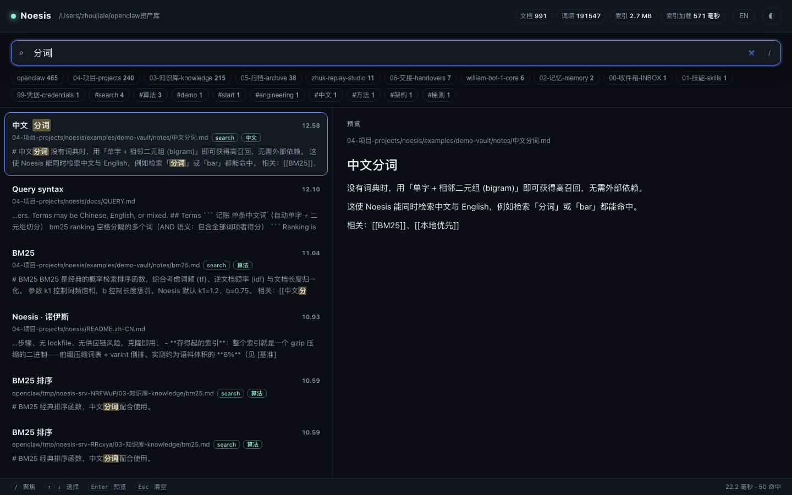

<div align="center">

# Noesis

**A zero-dependency, local-first knowledge framework.**
Compact binary index · BM25 · CJK + Latin search · incremental builds · wiki-link graph.


[中文](README.zh-CN.md) · [Architecture](docs/ARCHITECTURE.md) · [Index spec](docs/SPEC.md) · [Query syntax](docs/QUERY.md) · [Benchmarks](docs/BENCHMARKS.md)



</div>

## Built for two kinds of people

**You ship with AI, and your disk looks like it.** A dozen “final” folders on the Desktop, projects from three different tools, screenshots you will never find again. Noesis gives every generated project one home: drop it in, tell your agent to tidy, and it files itself by the rules that live in the library — with a receipt you can undo.

**Loose files make you twitch.** Same. `noesis tidy` shows the plan before it touches anything, never overwrites, never deletes, and prints the exact command that reverses the whole pass. If your idea of calm is a numbered top level and zero stray files at the root, this was written for you.

**You are tired of hunting.** One index over the whole library: instant search, the exact section rather than a 3,000-word file, backlinks and related notes. Stop opening six folders to find the one you remember writing.

**Your notes are nobody else's business.** No account, no sync service, no telemetry, and **no upload endpoint in the program**. The server binds `127.0.0.1` by default. The only outbound request is an optional version check: it sends a User-Agent and receives a tag, never your content, and works fine offline. Zero runtime dependencies, so there is no supply chain to trust. The full source is published (PolyForm Noncommercial — free for personal and research use).

```bash
git clone https://github.com/William-Trader/noesis.git
cd noesis
node bin/noesis.mjs onboard ~/Documents/my-library   # what to say to your agent
node bin/noesis.mjs tidy    ~/Documents/my-library   # plan first, --yes to apply
```
## Why another knowledge base?

Most tools make you choose between a heavy desktop app, a cloud service, or a folder of Markdown with no search. Noesis is the third option, done properly.

- **Zero dependencies.** Plain Node ESM (`>=18`). No install step, no lockfile, no supply-chain surface. Clone and run.
- **Storage you can live with.** The whole index is one gzip-compressed binary: a front-coded term dictionary plus varint postings. Measured at **~6% of corpus size** (see [Benchmarks](docs/BENCHMARKS.md)).
- **Search that fits the text.** BM25 ranking with dictionary-free CJK tokenisation (unigram + bigram) *and* Latin words, in one index.
- **Incremental by default.** A content-hash + size + mtime manifest means unchanged notes are reused, never re-parsed.
- **A graph, not a folder.** `[[wikilinks]]` resolve by path, filename or title; get backlinks, orphans and dangling links.
- **Boring on purpose.** Plain-text Markdown + YAML frontmatter. Git-native and diffable. The index is derived data — delete it and rebuild.

## Quickstart

```bash
git clone https://github.com/William-Trader/noesis.git
cd noesis

node bin/noesis.mjs init   my-vault     # scaffold a vault
node bin/noesis.mjs build  my-vault     # build / update the index
node bin/noesis.mjs search my-vault 记账 bm25 tag:finance
node bin/noesis.mjs serve  my-vault     # http://127.0.0.1:4317
```

Try it on the bundled demo vault:

```bash
node bin/noesis.mjs build  examples/demo-vault
node bin/noesis.mjs search examples/demo-vault 分词
```

## Just ask your agent (no commands)

Hand it the folder and one sentence. The repo ships the contract the agent needs:

- **[docs/QUICKSTART-小白.md](docs/QUICKSTART-小白.md)** — three sentences you can paste ("帮我一键整理…", "把这个库带走…", "把移动硬盘上的改动拷回来…").
- **[docs/HANDOVER.md](docs/HANDOVER.md)** — the agent-side contract: what to check first, what must never happen, how to report.
- **[skills/noesis-library/SKILL.md](skills/noesis-library/SKILL.md)** — the skill itself, versioned next to the code so it travels with the library.

The round trip is complete in both directions:

```bash
noesis library pack my-vault --out /Volumes/DRIVE/my-vault.tar.gz   # carry it away
noesis sync my-vault --from /Volumes/DRIVE/my-vault --dry           # see what came back
noesis sync my-vault --from /Volumes/DRIVE/my-vault                 # bring it home
```

`tidy` and `sync` never delete, never overwrite silently, write the mapping table before touching the filesystem, and every pass can be undone.

## First contact (for agents)

When you touch this library for the first time, do not move anything on your own:

```bash
node bin/noesis.mjs library volumes  <library>                       # list candidate drives
node bin/noesis.mjs library home     <library> --set "/Volumes/MY"   # record the user choice
node bin/noesis.mjs library manual   <library>                       # generate 说明书.md for the user
```

1. **Ask the user which drive the library should live on** (`library volumes` lists candidates with free space; say so honestly when no external drive is mounted).
2. Record it with `library home --set` — this writes `_库位置.json` and appends to `_库志.jsonl`; the real move command is printed (`--move` runs it, and the source folder is **never** deleted for you).
3. Generate `说明书.md` (`library manual`, ZH+EN) and hand it to the user — it documents where the library lives, how to open it, how to back it up, how to recover files and where the trail is.

Portable helpers:

| Command | What it does |
|---|---|
| `library volumes` | Candidate drives + free space (ask before moving) |
| `library home [--set D] [--move]` | Show or record where the library lives |
| `library manual` | Generate the bilingual user manual |
| `library pack [--out F]` | Handover bundle, skips the rebuildable index/node_modules/venv |
| `library undo <csv> [--dry]` | Reverse a reorganisation from its mapping table |
| `library log [--tail N] [--add "op:detail"]` | Query / append the append-only trail |

Full details: [docs/PORTABLE.md](docs/PORTABLE.md).

## Local UI

One command builds the index, starts a hot local server and opens the browser:

```bash
node bin/noesis.mjs ui my-vault                   # watch is on: edits re-index themselves
node bin/noesis.mjs ui my-vault --no-open --port 4317
```

What makes it pleasant:

- **Instant** — results as you type (debounced, stale requests aborted). No Enter key.
- **Search that fits the text** — CJK and Latin in one query; `tag:` `path:` `-exclude` and `"phrases"` all work.
- **Keyboard-first** — `/` focus · `↑↓` move · `Enter` preview · `Esc` clear.
- **Facets** — click a directory or tag chip to narrow, click again to clear.
- **Preview pane** — rendered Markdown right there, no click-through to an editor.
- **Shareable links** — the query lives in the URL (`?q=...`).
- **Hot by design** — index and searcher stay in memory, note text is cached by mtime, and a file watcher re-indexes on change.

Measured on a real 1,042-note vault: full build **641 ms**, index **2.8 MB** (191,547 terms), search **~1 ms** server-side, 50 sequential queries in **0.31 s**.

Dark/light, mobile-aware layout, zero dependencies, no external assets.

## Commands

| Command | Description |
|---|---|
| `init [dir]` | Create `kb.config.json` and a starter note |
| `build [dir] [--full]` | Build or incrementally update the index |
| `search <dir> <query>` | BM25 search (`tag:` `path:` `-exclude`, literal `"phrases"`, `--as-of`) |
| `related <dir> <note>` | Nearest notes on the wiki-link graph |
| `stats [dir]` | Index statistics: documents, passages, segments, freshness (`--json`) |
| `graph [dir]` | Backlinks, orphans, hubs, dangling links |
| `doctor [dir]` | Health check: broken links, missing/duplicate titles |
| `ui [dir]` | Build + serve + open the browser (watch on by default) |
| `serve [dir] [--port N]` | Local search server (binds 127.0.0.1; `--host` / `--token` to widen) |
| `mcp [dir]` | MCP server over stdio: search / read / related / stats / library / tidy / sync tools |
| `tidy [dir] [--yes]` | One-click organise: plan first, `--yes` applies it (reversible) |
| `sync [dir] --from <copy>` | Bring edits back from a portable copy (old files are backed up) |
| `onboard [dir]` | First-contact wizard + the paragraph to hand to an agent |
| `undo <dir> <op_id>` | Reverse one tidy/sync pass |
| `update [dir] [--force]` | Compare with the latest GitHub release (6 h cache) |

## Notes are just Markdown

```markdown
---
title: BM25
tags: [search, 算法]
date: 2026-10-11
---

# BM25

经典排序函数，相关笔记：[[中文分词]]、[[本地优先]]。
```

- **Frontmatter** — `title`, `tags`, `date` (a tiny YAML subset, no dependency).
- **Links** — `[[wikilinks]]` and relative Markdown links feed the graph.
- **Titles** fall back to the first H1, then the filename.

## How the index works

```
.noesis/segments/seg-00001.bin   gzip( [header][meta][docTable][termDict+postings] )
.noesis/manifest.json            version 2: segments + per-file hash/size/mtime + tombstones
```

A build **appends** a segment containing only what changed instead of rewriting the vault; a query merges the segments (later wins) and compaction folds them back when it pays off. Terms are front-coded (shared-prefix compressed) and postings are varint gap-encoded, so the dictionary scales with shared prefixes rather than raw text. Full format: [docs/SPEC.md](docs/SPEC.md).

Long notes (20 KB and up) are additionally split on headings into **passages**: ranking uses the best passage, and the snippet comes from that section, so a hit answers "which part" and not just "which file".

## Benchmarks

Reproducible via `node bench/benchmark.mjs [N]`. Measured on Apple Silicon / Node 24:

| corpus | docs | index size | ratio | build | search |
|---|---|---|---|---|---|
| 7.78 MB | 2,000 | 474 KB | 5.95% | 0.41 s | 0.42 ms/query |
| 38.90 MB | 10,000 | 2.29 MB | 5.75% | 4.70 s | 7.5 ms/query |

Measured on a real 1,210-note library (0.5.0): full build **1.23 s**, edit one note **64 ms**, index **3.85 MB** with 4,001 passages (2.92 MB without them). The 64 ms figure is the whole point of the segment store: the same edit cost 630 ms when every build rewrote the index.

Details and caveats: [docs/BENCHMARKS.md](docs/BENCHMARKS.md).

## Organizing a library (agent-ready)

Noesis ships the conventions for running a *library* (an asset vault), not just an index. Point an agent at this repo plus your vault and it organises by the book — the full spec is [docs/LIBRARY.md](docs/LIBRARY.md).

```bash
node bin/noesis.mjs library init  my-library   # scaffold the numbered structure + _整理规范.md + INDEX.md
node bin/noesis.mjs library check my-library   # audit: stray root entries, missing dirs, leaked credentials
node bin/noesis.mjs library dups  my-library   # content-level dedupe (size group first, hash within the group)
node bin/noesis.mjs library index my-library   # regenerate INDEX.md
node bin/noesis.mjs build         my-library   # (re)build the search index
```

The five rules the agent works by:

1. **Numbered top level** — `00-收件箱-INBOX` (inbox) … `99-凭据-credentials` (secrets); nothing lives loose at the root.
2. **Move, never delete** — every move is appended to `_重组映射表-<date>.csv` (`src,dst,type`), so a whole pass can be rolled back.
3. **Deduplicate by content** — group by size, hash only inside a group, trust the hash and never the filename; discard to the trash, not `rm`.
4. **Isolate secrets** — keys and certs only under `99-凭据-credentials/`, `chmod 600`.
5. **Regenerate `INDEX.md`** after every pass — it is the only index the agent trusts.

`library check --json` returns the whole audit as data, so an agent can act on it without parsing prose.

### Agents: MCP, not terminal scraping

```bash
node bin/noesis.mjs mcp my-library
```

Speaks stdio JSON-RPC 2.0 and exposes nine tools:

| Group | Tools |
|---|---|
| Read | `noesis_search`, `noesis_read` (optionally one section), `noesis_related`, `noesis_stats`, `noesis_library_check`, `noesis_library_log` |
| Write (transactional) | `noesis_organize_plan` (dry run), `noesis_apply_moves`, `noesis_undo` |

An agent gets structured JSON with `as_of`, `drift` and `section`, and never has to parse a coloured table. Mutations are safe by construction: the mapping table is written **before** the filesystem changes, a destination that already exists is refused (never overwritten), nothing is deleted, and every pass returns an `op_id` that `noesis_undo` reverses. A pass is capped at 200 moves.

## Development

```bash
node --test           # unit tests (node:test, zero deps)
node bench/benchmark.mjs 5000
```

## License

**PolyForm Noncommercial License 1.0.0** — source-available, *not* OSI open-source. Non-commercial use only. See [LICENSE](LICENSE).

---

*Noesis ships as a framework. It contains no personal data and no credentials; bring your own vault.*
